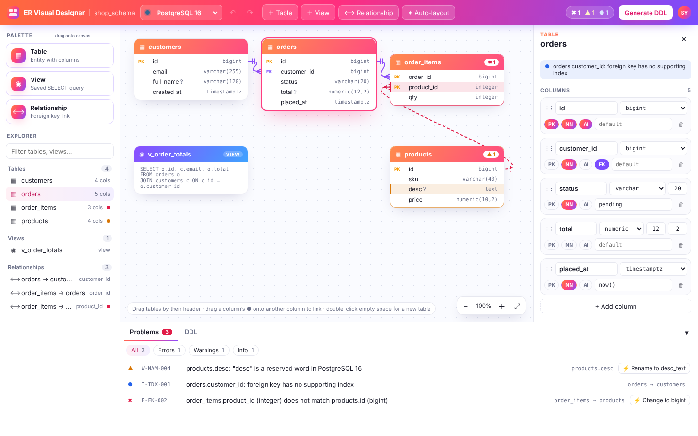

# ER Visual Designer

A web-based tool for visually designing relational database schemas. Draw tables and relationships on a canvas, have them checked against the rules of your chosen database engine, and generate ready-to-run DDL.



> **Status: Phase 1 implemented.** The visual modelling UI works: you can create and edit tables, columns, primary keys and foreign keys, drag tables around the canvas, and link columns to create relationships. Engine-specific types, validation and DDL come in Phases 2–5.

## Quick start

**Try it without installing anything:** open [`preview/index.html`](preview/index.html) in a modern browser (Chrome, Edge, Firefox or Safari). It is a single, self-contained file.

**Run from source** (Node.js 20.19+):

```bash
npm install
npm run dev          # start the app at http://localhost:5173
npm test             # unit tests (model, commands, undo/redo, file format)
npm run typecheck    # TypeScript checks for both packages
npm run build        # production build → packages/web/dist
npm run build:preview  # rebuild the single-file preview → preview/index.html
```

### Using Phase 1

| To… | Do this |
|---|---|
| Add a table | Drag **Table** from the palette onto the canvas, double-click empty canvas, press `T`, or click **＋ Table** |
| Edit a table | Select it; use the editor on the right (name, schema, colour, columns, comment) |
| Edit columns | Name, type, length or precision/scale, **PK** / **NN** (NOT NULL) / **AI** (auto-increment), default value (`ƒx` = expression such as `now()`), comment, reorder, delete |
| Rename on the canvas | Double-click a table header or column name |
| Create a foreign key | Hover a column and drag its ● handle onto a column in another table. Dropping a primary-key column onto a table's header creates a matching FK column there |
| Edit a relationship | Click the line: name, column pairs (composite keys), `ON DELETE` / `ON UPDATE` |
| Move tables | Drag the header; Shift-drag on the canvas to select several; arrow keys nudge (Shift = bigger steps) |
| Arrange automatically | **✦ Auto-layout** (arranges only the selected tables when several are selected) |
| Undo / redo | `Ctrl+Z` / `Ctrl+Y` (or `Ctrl+Shift+Z`) |
| Save / open | Work is autosaved in the browser. **File ▾** → *Save as .erd.json* (`Ctrl+S`) / *Open .erd.json…* (`Ctrl+O`) / *Open sample* |
| Other shortcuts | `Delete` delete selection · `Ctrl+D` duplicate table · `Ctrl+A` select all · `F2` rename selected table · `Esc` clear selection |


## What it will do

- **Model visually:** create tables and columns with data types, primary keys, foreign keys, nullability and default values.
- **Arrange and link:** drag tables around an interactive canvas, and drag one column onto another to create a foreign key.
- **Target a specific database:** PostgreSQL, MySQL, SQL Server, Oracle or SQLite, with that engine's types, naming rules and constraints.
- **Validate as you work:** errors and warnings appear on the tables themselves and in a Problems panel, each with a plain explanation and a one-click fix.
- **Generate DDL:** view the database-specific script live on screen and export it to a `.sql` file.
- **Later phases:** connect to a live database and import its tables, edit data and load rows from Excel, and monitor database performance.

## Repository contents

| Path | What it is |
|---|---|
| [`ER-Visual-Designer-Design.pdf`](ER-Visual-Designer-Design.pdf) / [`.html`](ER-Visual-Designer-Design.html) | **System design**: architecture, component and sequence diagrams, domain model, database dialects, validation rules, DDL generation, UI design system, API and security |
| [`ROADMAP.md`](ROADMAP.md) (also [`.pdf`](ROADMAP.pdf) / [`.html`](ROADMAP.html)) | **Delivery roadmap**: the 8 phases, each with scope, UX, technical design, key sequence diagram and acceptance criteria |
| [`mockups/`](mockups/) | **Interactive UI mockups**: three visual directions; open [`mockups/index.html`](mockups/index.html) to compare them |
| [`assets/wireframes/`](assets/wireframes/) | Component diagram and per-phase wireframes used by the documents |
| [`packages/model/`](packages/model/) | **Schema model** (TypeScript, no UI): types, logical data types, undoable commands (Immer patches), history with typing coalescing, drag-to-link rules, `.erd.json` format with validation and migrations, unit tests |
| [`packages/web/`](packages/web/) | **Web app** (React + Vite + React Flow + Zustand + Tailwind): top bar, palette and explorer, canvas, table and relationship editors |
| [`preview/index.html`](preview/index.html) | Single-file build of the app that opens straight from disk (generated by `npm run build:preview`) |

The HTML documents and mockups are self-contained, so you can open them directly in a browser with no build step or server.

## Chosen design: Sunrise Studio

The UI follows **Option B — Sunrise Studio**: a light, docked, IDE-style workspace with a coral → magenta → violet gradient. Try it at [`mockups/option-b-sunrise-studio.html`](mockups/option-b-sunrise-studio.html). The design tokens, component styling, accessibility checks and responsive rules are in §9 of the design document.

| Area | Purpose |
|---|---|
| Top bar | Database selector, undo/redo, add Table / View / Relationship, problem count, **Generate DDL** |
| Left panel | Palette to drag Table, View and Relationship onto the canvas, plus an explorer with a filter |
| Canvas | Table and view cards, with relationship lines drawn column to column |
| Right panel | Table editor: columns, types, sizes, PK / NOT NULL / auto-increment, defaults |
| Bottom panel | **Problems** (with quick fixes) and **DDL** (generate, review, copy, download) |

## Roadmap

| Phase | Scope | Status |
|---|---|---|
| 1 | Responsive web UI: tables, columns, PKs and FKs; drag tables; link tables for FKs | ✅ Done |
| 2 | Database engines: engine-specific types and validation | Next |
| 3 | Errors and warnings highlighted on tables and in a Problems panel | Planned |
| 4 | DDL shown on screen | Planned |
| 5 | Export DDL to a file | Planned |
| 6 | Connect to a real database; list its tables in the left panel and import them onto the canvas | Planned |
| 7 | DML on the connected database; load tables from Excel | Planned |
| 8 | Performance metrics for the connected database | Planned |

See [`ROADMAP.md`](ROADMAP.md) for the design of each phase.

## Technology

| Concern | Choice |
|---|---|
| Language | TypeScript (monorepo) |
| Front end | React 19 + Vite, React Flow (`@xyflow/react`) for the canvas, Zustand + Immer (state with undo/redo), Radix UI + Tailwind CSS 4, ELK.js (auto-layout) |
| Code view (Phase 4) | Monaco editor |
| Storage | IndexedDB autosave (`idb-keyval`), `.erd.json` project files |
| Backend (Phase 6+) | Node.js + Fastify with drivers for PostgreSQL, MySQL, SQL Server, Oracle and SQLite |
| Testing | Vitest (unit); browser end-to-end and Testcontainers (real databases) to be added as the phases need them |

## Supported databases (planned)

PostgreSQL 16/17 · MySQL 8.0/8.4 · SQL Server 2019/2022 · Oracle 19c/23ai · SQLite 3

## License

Licensed under the [Apache License 2.0](LICENSE).
