# ER Visual Designer — Delivery Roadmap

The phased delivery plan, with a design for each phase. Read it alongside the system design (`ER-Visual-Designer-Design.html` / `.pdf`), which describes the target architecture these phases build towards.

<div class="meta"><span><b>Document</b> Roadmap &amp; phase designs</span><span><b>Version</b> 1.1 (draft)</span><span><b>Date</b> 8 November 2026</span><span><b>Status</b> <span class="pill">Planning — no implementation yet</span></span></div>

<!--TOC-->

## Overview

### Phase summary

| Phase | Theme | Outcome for the user | Backend needed | Indicative effort |
|---|---|---|---|---|
| **1** | Visual modelling UI | Modern, responsive app: create/edit tables, columns, PKs, FKs. Drag tables and link them on a canvas | No | 8 weeks |
| **2** | Database engines | Pick an engine; types, naming and constraint rules become engine-specific; model validated in the background | No | 5 weeks |
| **3** | Problems & highlighting | Errors and warnings shown on tables and columns and in a Problems panel, with explanations and quick fixes | No | 3 weeks |
| **4** | DDL on screen | Live, syntax-highlighted DDL for the chosen engine, linked to the canvas selection | No | 3 weeks |
| **5** | DDL export | Export to `.sql` (single file, per table, or migration diff) with options | No | 2 weeks |
| **6** | Live database connection | Connect to a real database, browse its tables in the left panel, view details, import onto the canvas | **Yes** | 6 weeks |
| **7** | Data & DML, Excel | Browse/edit table data and load rows from Excel, applied as DML in a transaction | Yes | 6 weeks |
| **8** | Performance utilities | Live performance metrics of the connected database: connections, throughput, locks, top queries, advice | Yes | 5 weeks |

*Effort assumes a team of three engineers (two front-end, one full-stack) plus part-time design and QA. Re-estimate it at the start of each phase.*

### Timeline (indicative)

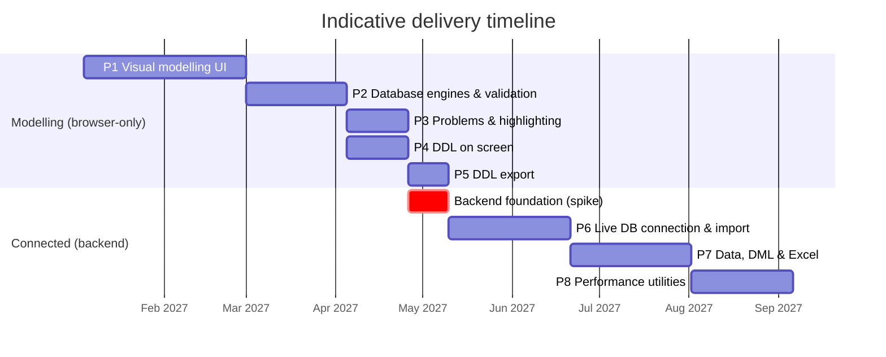

*Phases 3 and 4 can run in parallel once Phase 2's validation and dialect packages are stable. A two-week backend spike (auth, connection pooling, secrets) during Phases 4–5 reduces the risk of starting Phase 6 cold.*

### Phase dependencies

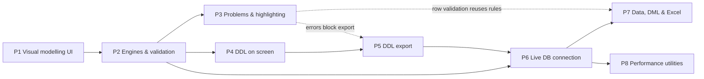

### Definition of done (every phase)

- Features demoed against the phase's acceptance criteria; all criteria have automated tests (unit, component or end-to-end).
- Works on the latest Chrome, Edge, Firefox and Safari, at desktop (≥1280 px), tablet (768–1279 px) and phone (360–767 px) widths.
- WCAG 2.2 AA checks pass (axe), and every new interaction can be done with the keyboard alone.
- Performance budgets met (see each phase). No new console errors.
- Project file format changes include a migration and a test that opens files from earlier phases.
- User-facing docs and the changelog are updated, and the phase is tagged as a release.

## Phase 1 — Visual modelling UI

<span class="pill">8 weeks</span> <span class="pill">Browser only</span>

### Goal

A modern, responsive web app where users create and edit tables, columns, primary keys and foreign keys. They drag tables around a canvas and link them to create FK relationships. Phase 1 is engine-neutral: it uses logical types (`integer`, `bigint`, `decimal(p,s)`, `string(n)`, `text`, `boolean`, `date`, `timestamp`, `uuid`, `json`…). Engine-specific types arrive in Phase 2.

### Scope

| In scope | Out of scope (later phases) |
|---|---|
| Tables: create, rename, duplicate, delete, comment, colour tag | Engine-specific types and rules (P2) |
| Columns: name, logical type and parameters, nullable, default, auto-increment, comment, reorder | Validation badges / Problems panel (P3) |
| Primary keys (single and composite) | DDL (P4/P5) |
| Foreign keys: drag column-to-column, FK editor, composite FKs, `ON DELETE`/`ON UPDATE` | Database connectivity (P6+) |
| Canvas: drag, multi-select, pan/zoom, minimap, snap-to-grid, auto-layout, fit-to-screen | Indexes, unique and check constraints UI (added in P2) |
| Undo/redo, autosave (IndexedDB), open/save `.erd.json`, new/sample project | Real-time collaboration |
| Responsive layout, light/dark theme, keyboard shortcuts | |

### UX design

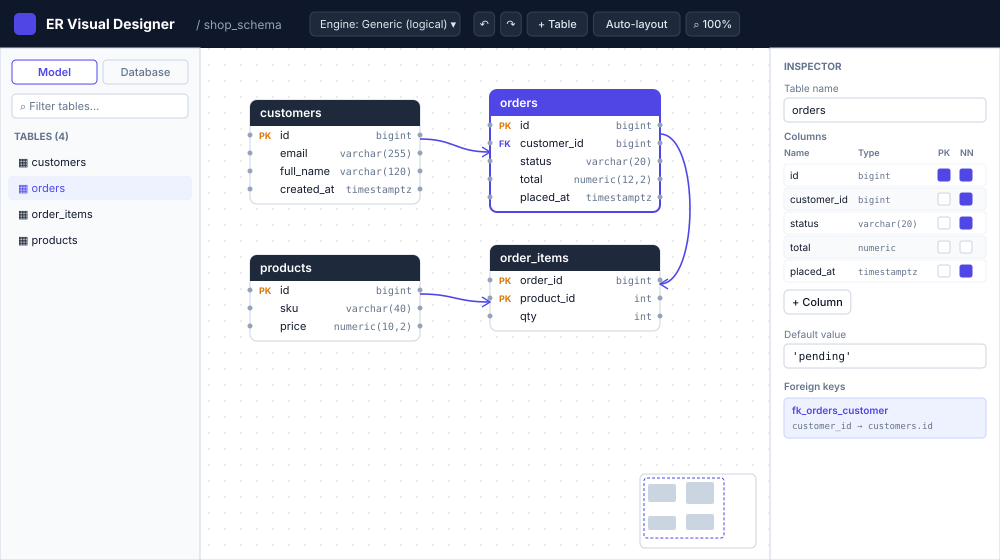

*Figure P1-1 — Desktop workspace structure: Explorer (left), canvas with minimap (centre), Inspector (right). The engine selector reads "Generic (logical)" until Phase 2. The visual styling follows the chosen Sunrise Studio direction (design §9.1).*

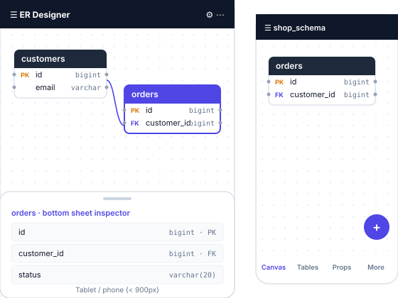

*Figure P1-2 — Responsive behaviour. Below 900 px the Explorer becomes a drawer (☰) and the Inspector becomes a bottom sheet. On phones a bottom tab bar switches Canvas / Tables / Properties, and a floating "+" adds a table. Touch: one-finger drag moves a table, two fingers pan and pinch to zoom, long-press opens the context menu.*

**Design notes**

- **Table cards** show the name in the header and one row per column: key marker (PK/FK), name, type. Every column row has connection handles on both sides, so FKs are drawn column-to-column.
- **Inline editing:** double-click a table or column name to rename it on the canvas. Everything else is edited in the Inspector.
- **Inspector column grid:** an editable grid with Tab/Enter navigation, row drag-to-reorder, and PK/NN checkboxes. Type parameters (length, precision, scale) appear only when the chosen type needs them.
- **FK editor:** a dialog listing column pairs (child → parent), name, `ON DELETE`/`ON UPDATE`, and a cardinality preview.
- **Empty state:** "Create your first table", "Open sample (e-commerce)", "Import .erd.json".
- **Design system:** the chosen **Sunrise Studio** direction (light, docked layout, coral→magenta→violet gradient; see design §9.1–9.7 and `mockups/option-b-sunrise-studio.html`). Radix primitives + Tailwind themed from one token file; use the accessible *production* colour values from design §9.6. A dark theme can be derived from the same tokens later.

### Technical design

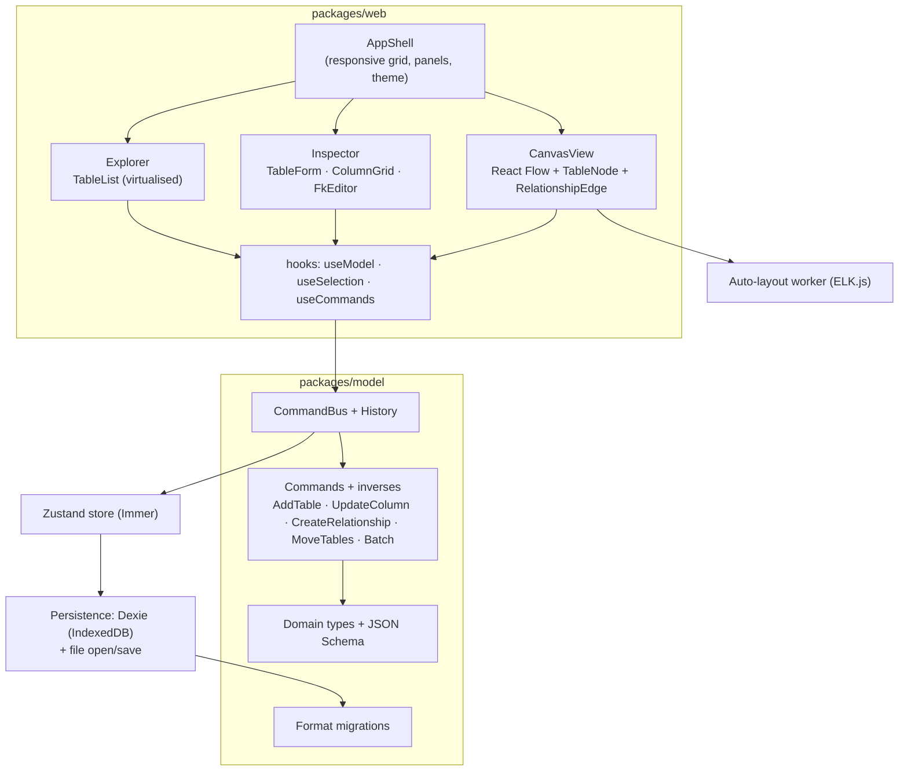

*Figure P1-3 — Phase 1 modules. `packages/model` contains no UI code and is fully unit-tested.*

**Key decisions**

| Topic | Decision |
|---|---|
| Canvas | React Flow custom node per table; one handle per column (`source`/`target` on both sides); custom edge with crow's-foot markers; `onlyRenderVisibleElements` for large models |
| Drag | Transient positions in React Flow; a single `MoveTables` command on drag stop (one undo step) |
| FK by drag | `isValidConnection` blocks self-column links and duplicate FKs. Dropping on a table header (not a column) creates a new child column `<parent>_<pk>` |
| Undo | Command + inverse, history capped at 500 entries. Typing in one field is coalesced within 800 ms |
| Autosave | Debounced 500 ms to IndexedDB; restore prompt after a crash; `beforeunload` guard for unsaved file changes |
| IDs | ULIDs for all elements; layout kept separate from schema |

### Canvas interaction states

| Mode | Entered by | Ends with | Command emitted |
|---|---|---|---|
| **Idle** | default | — | — |
| **Panning** | Space + drag, two-finger drag, middle mouse | release | none (viewport only) |
| **Dragging tables** | pointer down on table header (moves the whole selection) | pointer up | `MoveTables` (one undo step) |
| **Connecting** | drag from a column handle | drop on column / drop on table header / `Esc` | `CreateRelationship`, or `Batch[AddColumn, CreateRelationship]` |
| **FK dialog** | drop needs confirmation (type mismatch, target not unique) | Confirm / Cancel | `Batch[UpdateColumn \| AddUnique, CreateRelationship]` |
| **Marquee select** | drag on empty canvas (Shift adds to selection) | release | none (selection only) |
| **Inline rename** | double-click a name, or `F2` | `Enter` / `Esc` / blur | `RenameTable` / `RenameColumn` |

*Canvas interaction modes. The canvas is a state machine with exactly one active mode, which owns the pointer handlers, so gestures never conflict. Every mode returns to Idle, and every mode has a keyboard equivalent.*

### Key sequence — restore work on startup

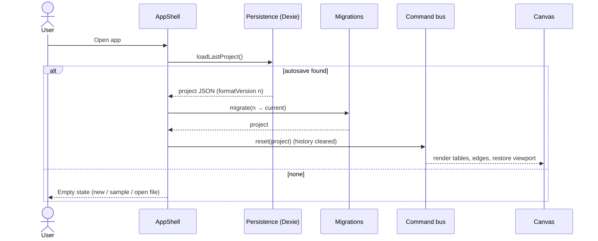

### Acceptance criteria

1. A user can create a table, add five columns with types, mark a composite PK and set NOT NULL/defaults without using the keyboard for anything except names.
2. Dragging from `orders.customer_id` to `customers.id` creates an FK, shown as an edge with correct cardinality markers. Undo removes it in one step.
3. Dragging a column onto another table's header creates a correctly typed child column and the FK.
4. Moving 10 selected tables, then undo, returns all 10 to their original positions.
5. Reloading the browser restores the model, layout and viewport exactly.
6. A 200-table sample model pans, zooms and drags at ≥ 55 fps on a mid-range laptop. A 1,000-table model stays interactive.
7. All of the above works on a tablet (touch), and the phone layout lets the user add and edit a table.

### Risks

| Risk | Mitigation |
|---|---|
| React Flow handles per column on large tables hurt performance | Memoised nodes; collapse long tables (> 30 columns) with "show all" |
| Touch drag conflicts with panning | Explicit gesture rules (one finger on table = move, on canvas = pan); test on real devices |

## Phase 2 — Database engines & validation

<span class="pill">5 weeks</span> <span class="pill">Browser only</span>

### Goal

The model becomes **engine-specific**. The user chooses an engine and version, and type pickers, identifier rules, auto-increment syntax and constraint capabilities follow that engine. A validation engine checks the model continuously in the background. Phase 2 produces the issue data; Phase 3 presents it in full.

### Scope

- Dialect plug-in interface and five dialects: PostgreSQL, MySQL, SQL Server, Oracle, SQLite (tier-1 versions below).
- Engine/version selector in the toolbar, and an engine choice in the new-project dialog.
- Engine-aware type picker with parameter ranges, aliases (e.g. `int4` → `integer`) and categories.
- Conversion between engines through logical types, with a review dialog listing lossy mappings.
- Validation engine running in a Web Worker, with the initial rule catalogue (naming, types, defaults, PK, FK, identity).
- Unique constraints, check constraints and indexes added to the Inspector.
- Minimal issue indication in this phase: an error/warning count in the status bar and inline field errors in the Inspector.

| Engine | Tier-1 versions | Notable rules |
|---|---|---|
| PostgreSQL | 16, 17 | 63-byte identifiers; lower-case folding; `GENERATED … AS IDENTITY` |
| MySQL | 8.0, 8.4 | 64-char identifiers; one `AUTO_INCREMENT` per table and it must be a key; `VARCHAR` needs a length |
| SQL Server | 2019, 2022 | 128-char identifiers; `IDENTITY`; `DECIMAL` precision ≤ 38 |
| Oracle | 19c, 23ai | 128-byte identifiers; upper-case folding; no `ON UPDATE` FK actions; `BOOLEAN` only in 23ai |
| SQLite | 3.4x | Type affinity; `INTEGER PRIMARY KEY` rowid alias; FKs only inline |

### UX design

- **Engine selector** in the toolbar: `PostgreSQL 16 ▾`, grouped by engine with versions. Changing it opens the **conversion review**: a table of *column · from · to · note*, with lossy rows marked ⚠. The whole change undoes in one step.
- **Type picker:** a searchable combobox grouped by category (Numeric, Text, Date/Time, Binary, Boolean, JSON, Spatial, Other). It shows parameter inputs with the allowed range as a hint ("length 1–10485760"). Aliases resolve to the canonical name.
- **Inline field errors** in the Inspector: a red outline plus a message under the field, e.g. *"Name exceeds 63 bytes — PostgreSQL will truncate it"*.
- **Status bar:** `● 2 errors ▲ 5 warnings` (clickable; becomes the Problems panel in P3).

### Technical design

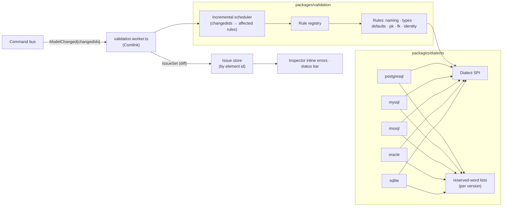

*Figure P2-1 — Validation architecture. The worker receives the model snapshot (structured clone) and changed IDs, then returns an issue diff. Only affected issues are replaced.*

### Key sequence — incremental validation while editing

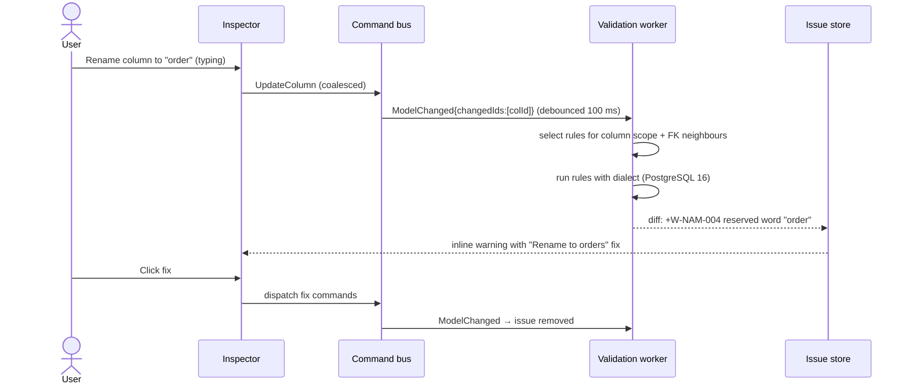

### Acceptance criteria

1. Switching a 50-table model from PostgreSQL to MySQL shows a conversion review. After confirmation every column has a valid MySQL type, and undo restores the PostgreSQL model exactly.
2. Each rule in the catalogue has unit tests with passing and failing fixtures for every dialect it applies to.
3. A 200-table model validates fully in < 500 ms and incrementally in < 150 ms. Typing in the Inspector never drops below 55 fps.
4. Type pickers list only types valid for the selected engine and version, and reject out-of-range parameters.
5. Every dialect fact used by a rule (length limits, reserved words, capabilities) is backed by a conformance test that runs on the real engine (Testcontainers).

## Phase 3 — Problems panel & highlighting

<span class="pill">3 weeks</span> <span class="pill">Browser only</span>

### Goal

Validation results become visible and actionable everywhere: **badges and highlights on tables, columns and relationships**, and a **Problems panel** that lists, groups, explains and fixes issues.

### UX design

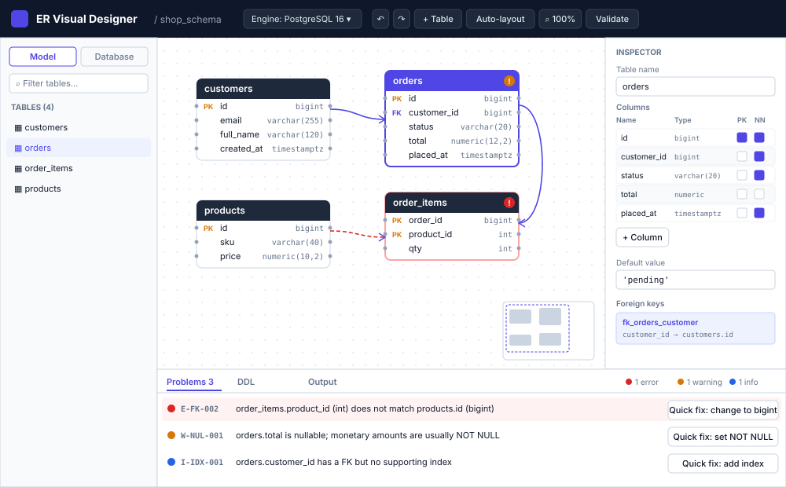

*Figure P3-1 — Table cards show the highest severity as a header badge. The `order_items` card has a red outline and a dashed red relationship edge for a type mismatch. The Problems panel lists every issue with its rule code, message and quick fix.*

| Element | Error | Warning | Info |
|---|---|---|---|
| Table card | Red outline + ✖ badge with count | Amber ▲ badge | Blue ● dot (optional, off by default on canvas) |
| Column row | Red underline + ✖ icon at row end | Amber ▲ icon | — |
| Relationship edge | Dashed red with ✖ marker at midpoint | Dashed amber | — |
| Minimap | Red dots at error locations | Amber dots | — |
| Tooltip (hover/focus) | Message + "Show in Problems" + first quick fix | Same | Same |

**Problems panel behaviour**

- Tabs at the bottom (Problems · DDL · Output), with severity counts in the tab label.
- **Group by** table (default), rule, or severity. **Filter** by text, severity toggles, and "current selection only".
- Clicking a row selects the element, scrolls the canvas to it with a short pulse animation, and focuses the related Inspector field.
- Each row expands to show the **explanation** (why it matters on this engine, with a documentation link) and **fixes**. *Fix* applies one fix; *Fix all n similar* applies a batch with one undo step.
- Keyboard: `F8` / `Shift+F8` move through problems, `Enter` jumps to the element, `Ctrl+.` opens the quick-fix menu (as in code editors).
- **Suppress** a warning or info (per element or per rule) with a reason. Suppressions are stored in the project and shown under a "Suppressed" filter.

### Technical design

- `IssueStore` (from P2) gains selectors: `issuesByElement`, `worstSeverity(tableId)`, `countsBySeverity`, `grouped(groupBy, filter)`.
- `TableNode` and `RelationshipEdge` subscribe through `useIssues(elementId)`, so only affected nodes re-render.
- Problems panel: a virtualised list (handles thousands of issues). Group headers are collapsible.
- `QuickFix = { label, commands: Command[], scope: 'single' | 'all-similar' }`. Applying a fix always goes through the command bus, so it can be undone.
- Navigation: `selection.focus(elementId, field?)` → the canvas calls `fitView({nodes:[id], padding})` and the Inspector focuses `field`.

### Key sequence — "Fix all similar"

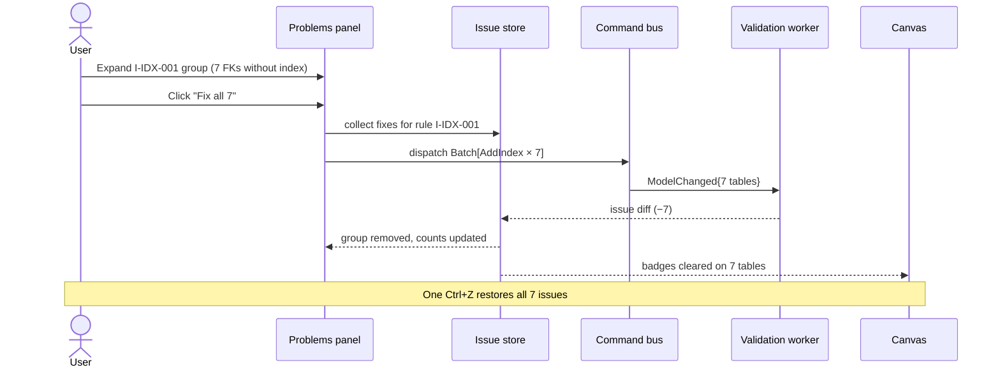

### Acceptance criteria

1. Every issue type is visible both on the canvas (or Inspector for model-level issues) and in the Problems panel, and selecting one shows the other.
2. Severity is shown by icon and text as well as colour (passes a colour-blindness simulation check).
3. Applying any quick fix resolves its issue and can be undone in one step. "Fix all" of 100 issues completes in < 300 ms.
4. Problems panel remains smooth with 5,000 issues (virtualised).

## Phase 4 — DDL on screen

<span class="pill">3 weeks</span> <span class="pill">Browser only</span>

### Goal

Show the **DDL for the selected engine** on screen, updated live as the model changes, syntax-highlighted and linked both ways to the canvas.

### UX design

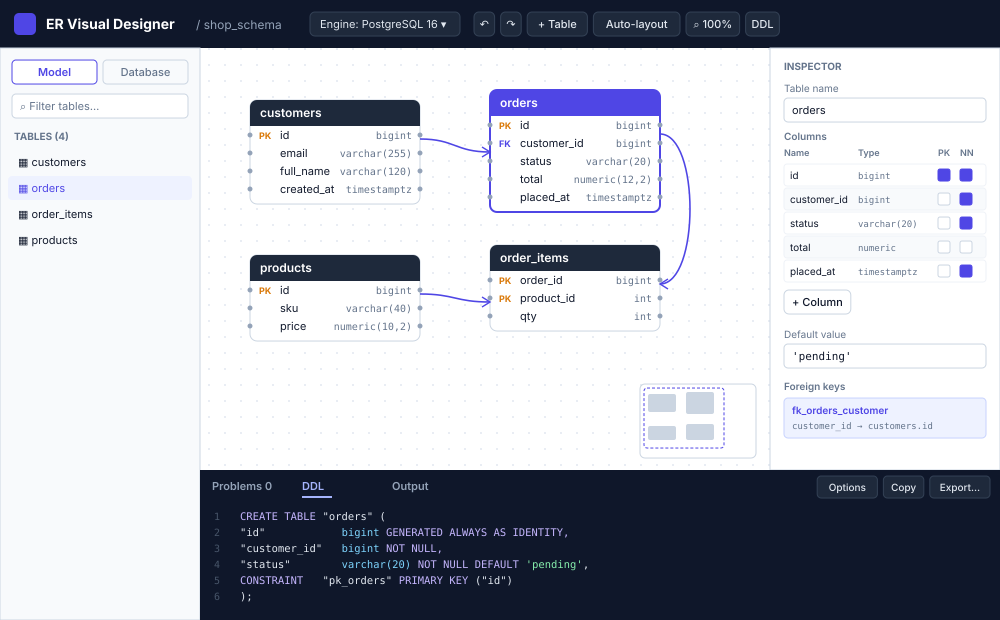

*Figure P4-1 — The DDL tab in the bottom panel (it can also be docked right or opened full screen). Monaco in read-only mode with SQL highlighting, line numbers, folding per statement, and search.*

- **Scope toggle:** *Whole model* or *Selection only*. *Selection only* includes the FKs between selected tables only.
- **Selection sync:** selecting a table highlights its statements. Clicking inside a statement selects the source element on the canvas (via the source map).
- **Options popover:** quote identifiers (when needed / always), FKs inline or as `ALTER TABLE` statements, include comments, statement terminator (`;` or `GO`), keyword case (UPPER/lower), indentation.
- **Copy** copies the whole script or the selected statements.
- If the model has **errors**, a banner above the editor reads *"The model has 2 errors — the script may fail. Show problems"*. The DDL is still shown, so users can see what is wrong.

### Technical design

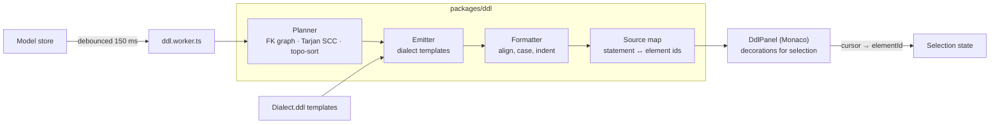

*Figure P4-2 — DDL generation runs in a worker and is cached per table, so editing one table regenerates only that table's statements and the affected FKs.*

- **Per-dialect templates** (functions, not string templates) cover `createTable`, `columnDef`, `identity`, `default`, `primaryKey`, `unique`, `check`, `foreignKey` (inline/alter), `index`, `comment` and `drop`.
- **Ordering:** CREATE in topological order. FKs as `ALTER TABLE` after all tables, except on SQLite, where they are always inline (SQLite allows forward references).
- **Golden-file tests:** a corpus of 20+ models (cycles, self-references, composite keys, reserved words, every type) × 5 dialects, snapshot-tested. In CI each script also runs on the real engine.

### Key sequence — live update and two-way selection sync

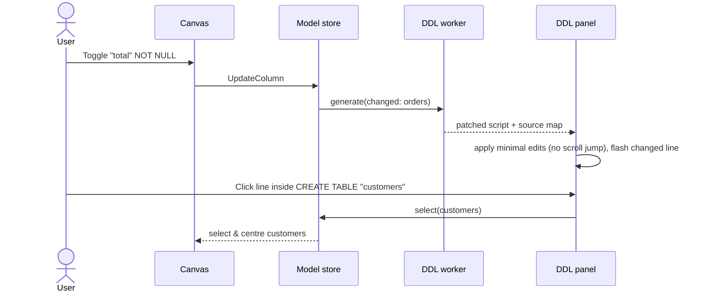

### Acceptance criteria

1. The DDL for the sample models runs without errors on all five engines in CI (Testcontainers), and introspecting the result back gives an equivalent model.
2. Models with FK cycles and self-references generate valid scripts on every engine.
3. Edits appear in the DDL view within 200 ms for a 200-table model, without losing the scroll position.
4. Selection sync works in both directions for tables, columns and FKs.

## Phase 5 — DDL export

<span class="pill">2 weeks</span> <span class="pill">Browser only</span>

### Goal

Export the generated DDL to files, configured for how the team uses them: one script, one file per table, or a **migration** script that changes an earlier version of the schema into the current one.

### UX design

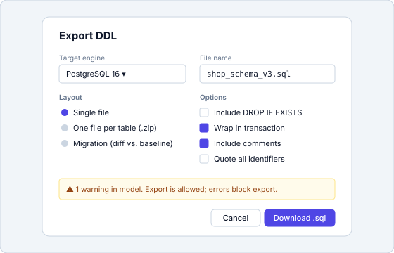

*Figure P5-1 — Export dialog. Errors block export, with a link to the Problems panel. Warnings are summarised but do not block. The dialog remembers its settings per project.*

| Option | Values |
|---|---|
| Layout | Single `.sql` · One file per table (`.zip`, numbered in dependency order) · Migration (diff vs. baseline) |
| Baseline (migration only) | A saved snapshot, a `.erd.json` file, or (from Phase 6) a live database |
| Content | `DROP … IF EXISTS` · wrap in transaction (only where DDL is transactional, e.g. PostgreSQL, SQL Server) · comments · header with model name, engine, timestamp, generator version |
| Format | Encoding UTF-8 (BOM optional for SQL Server tools) · line endings LF/CRLF · terminator `;` / `GO` |

### Technical design

- **Export service** (`packages/ddl/export`): `exportScript(model, dialect, options) → File[]`. It reuses the Phase 4 generator.
- **Saving:** File System Access API (Chromium) to choose a save location, with a standard download as fallback. JSZip builds the `.zip` layout.
- **Snapshots:** "Save snapshot" stores a named, timestamped copy of the model in the project file, to use as a migration baseline.
- **Diff engine** (`packages/ddl/diff`): matches elements by **stable ID**, so renames become `RENAME`, not drop-and-create. It emits ordered `ALTER` statements (drop FKs → alter/drop tables → create tables → add FKs). **Destructive changes** (drop column, narrow type) are listed as warnings, and the user must confirm them explicitly.

### Key sequence — migration export

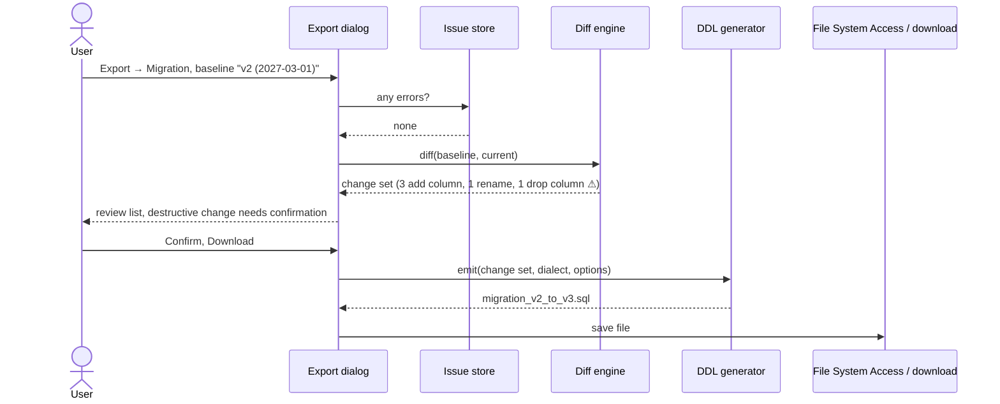

### Acceptance criteria

1. All three layouts produce files that run on the target engine in CI.
2. A column rename produces `ALTER … RENAME COLUMN`, never drop and add.
3. Export is blocked while errors exist, and the dialog explains why and links to them.
4. Exported files match what the DDL panel shows for the same options, byte for byte.

## Phase 6 — Live database connection & reverse engineering

<span class="pill">6 weeks</span> <span class="pill">Backend introduced</span>

### Goal

Connect to a **real database**. The left panel lists its schemas and tables. Clicking a table shows its details (columns, keys, indexes, row count, size), and the user can **import tables onto the canvas** to build or update a model from an existing database.

### UX design

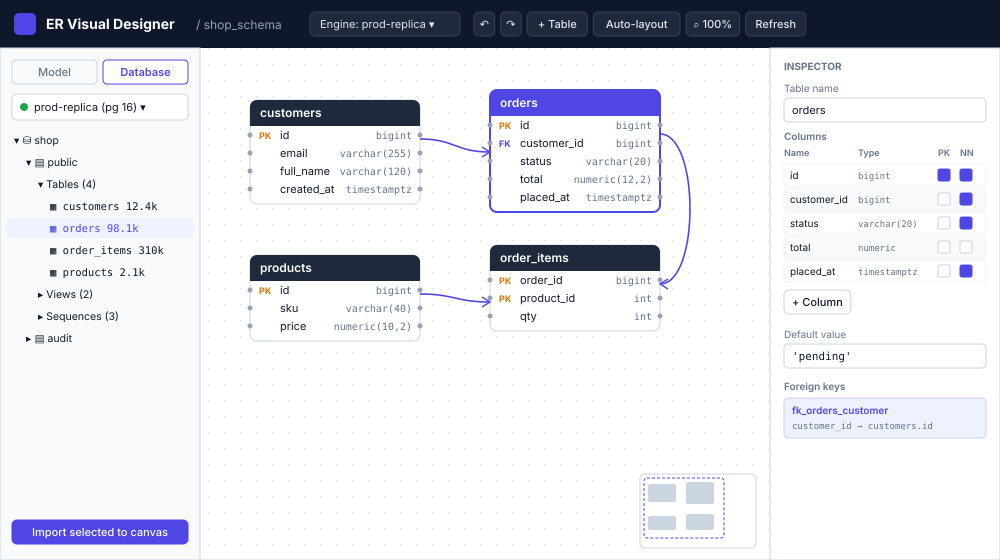

*Figure P6-1 — The Explorer's Database tab: connection picker with status dot, and a tree of database → schema → Tables / Views / Sequences with row estimates. The selected table's details open in the Inspector (read-only, with a "Details" sub-tab for indexes, size and DDL). Multi-select, then "Import selected to canvas".*

- **Connection dialog:** engine, host, port, database, user, password or integrated auth, TLS mode (with CA upload), SSH tunnel (optional), and a *read-only* toggle (on by default). "Test connection" shows the server version and the latency.
- **Explorer tree:** lazy-loaded with a search filter. Badges show tables that are **already on the canvas** and those that **differ from the model** (drift indicator).
- **Table details:** columns, PK, FKs (in and out), indexes, row estimate, size on disk, and the database's own DDL (where the engine can produce it).
- **Import:** select tables (optionally "+ related tables" through FKs), choose *add* or *replace*, and auto-layout the new tables near the viewport. If a model element already exists, the **compare & merge** view shows column-level differences.
- **Generate from database:** "New project from database" imports the whole schema in one step.

### Technical design

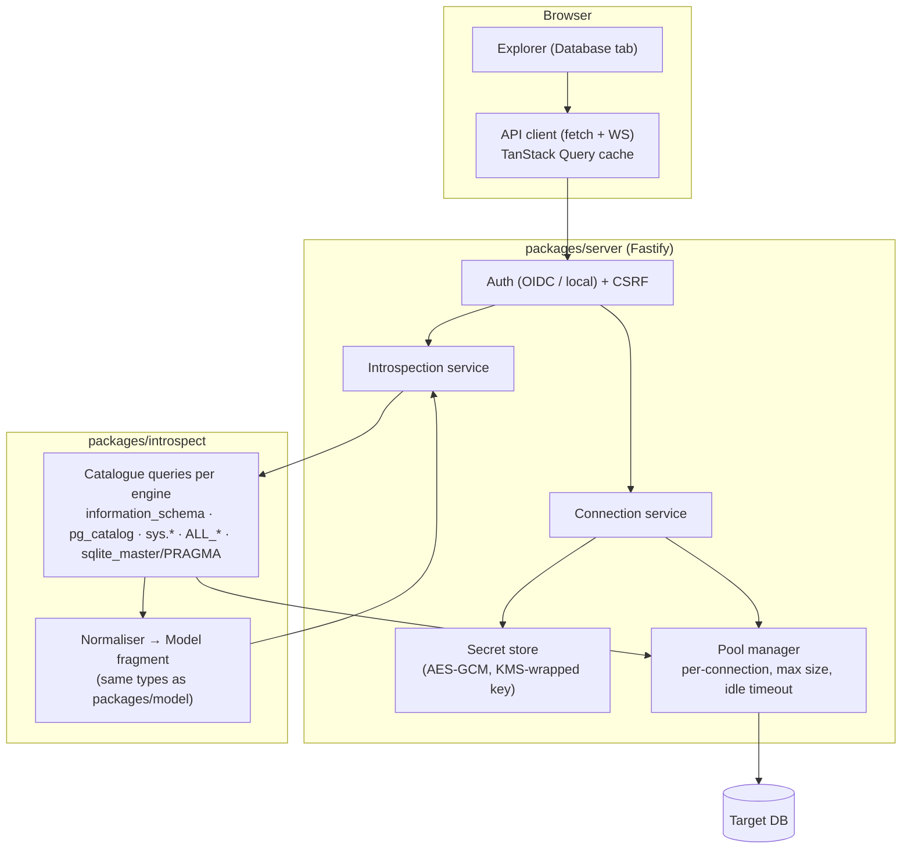

*Figure P6-2 — Introspection returns a model fragment in the same format the canvas already uses, so import is just a batch of normal commands, and it can be undone.*

**Security design (minimum for this phase)**

- Credentials go to the server once over TLS and are encrypted at rest. They are **never** returned to the browser or written to logs.
- Read-only by default. Where the engine allows it, the session also runs in read-only mode (`SET SESSION CHARACTERISTICS AS TRANSACTION READ ONLY` on PostgreSQL, `SET TRANSACTION READ ONLY` on MySQL).
- Statement timeout (e.g. 15 s) and maximum rows per catalogue request. Optional host allow-list.
- Audit log for connection create, test and use.

**Connection lifecycle**

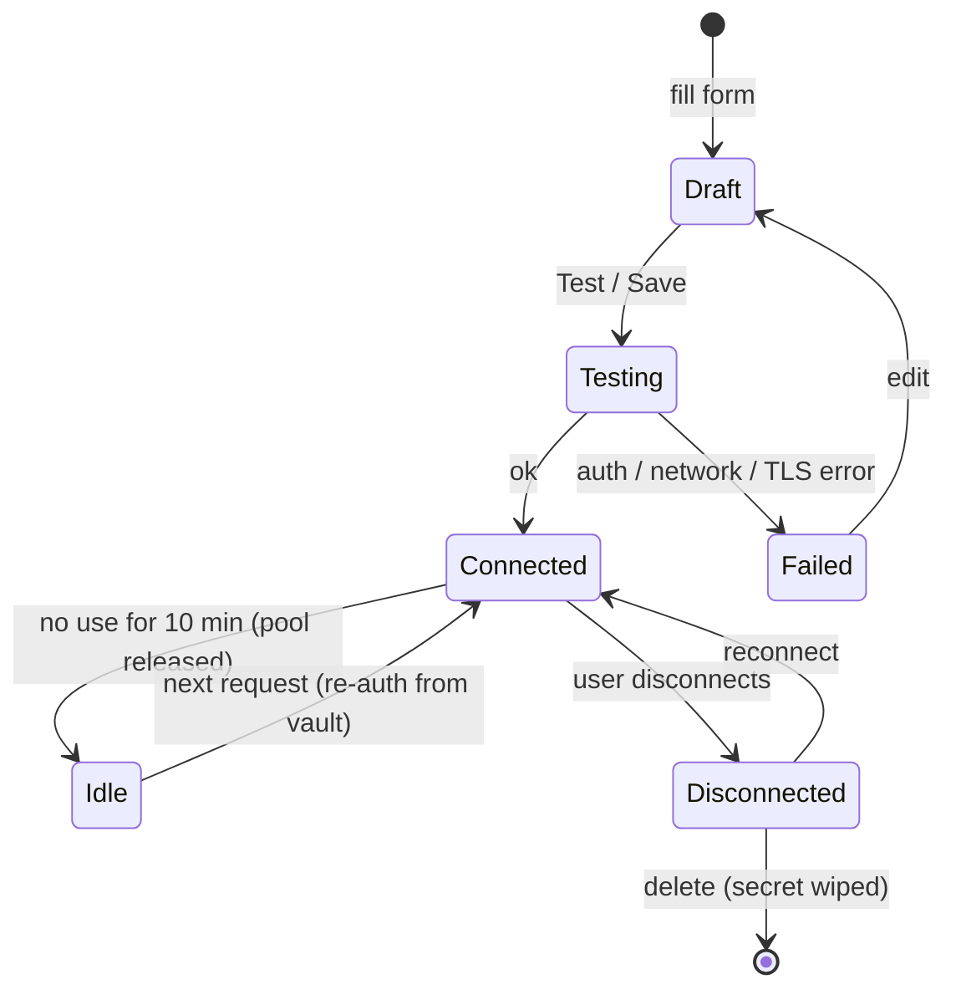

### Key sequence — browse and show table details

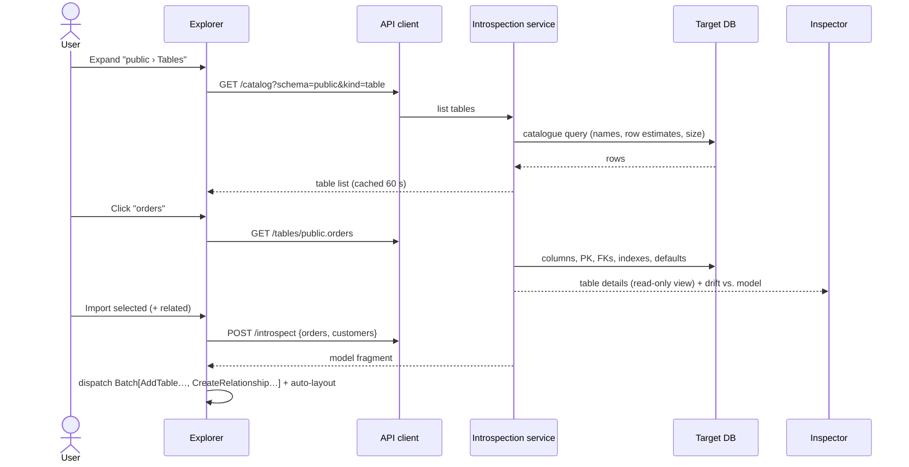

### Acceptance criteria

1. Connect, browse and import work on all five engines in CI against containerised databases with a 100-table sample schema.
2. Importing a schema and generating DDL for the same engine gives a script that recreates an equivalent schema (round-trip test).
3. A browser network trace never contains a password after the connection is created.
4. The catalogue for a 2,000-table database lists in < 2 s, using lazy loading and server-side search.
5. Unsupported objects (computed columns, custom types) are imported with a clear warning and never silently dropped.

## Phase 7 — Data, DML & Excel integration

<span class="pill">6 weeks</span> <span class="pill">Backend</span>

### Goal

Work with **data** in the connected database from the app: browse rows, insert, update and delete them through a grid, and **load rows from Excel** straight into a table. Every change is sent as parameterised DML in a single transaction, after a preview.

### UX design

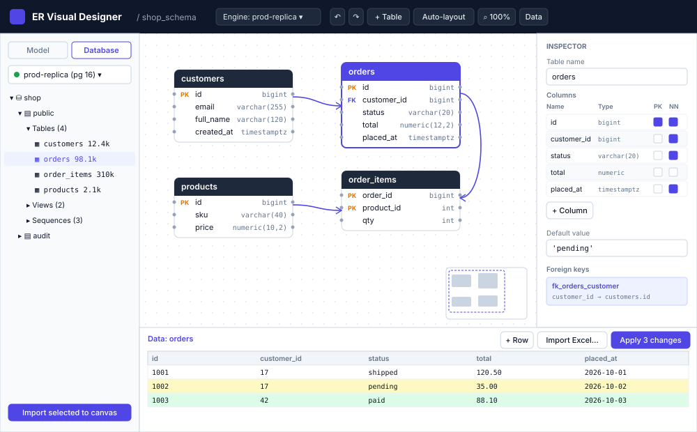

*Figure P7-1 — The Data tab for the selected table. Pending edits are colour-coded (yellow = modified, green = new, struck-through red = deleted) until "Apply n changes" runs them as one transaction.*

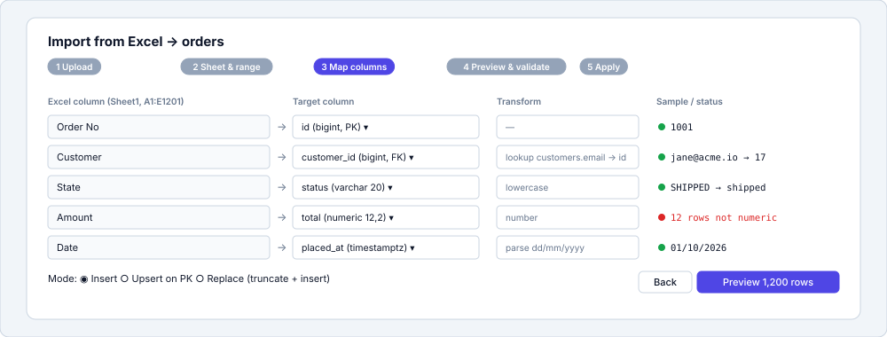

*Figure P7-2 — Excel import wizard (Upload → Sheet & range → Map columns → Preview & validate → Apply). Columns are auto-mapped by name and type. Transforms include trim, case, number/date parsing, and lookups (e.g. customer email → id) to satisfy FKs.*

**Data grid**

- Virtualised grid with keyset pagination (stable for large tables), column sort and filter (pushed down to SQL), and a column chooser.
- Cell editors chosen by column type: number, text, date/time picker, boolean toggle, JSON editor, and an FK picker that searches the parent table.
- **Change set:** edits are held on the client until *Apply*. *Review SQL* shows the exact statements and parameters.
- Shows a constraint error from the database next to the row that caused it.
- **Export to Excel / CSV** of the current view (filtered rows), so data can go out and come back in.

**Excel import**

- Parsing happens in the browser (SheetJS worker), so the file is not uploaded. Only the mapped rows are sent, in batches.
- Modes: *Insert*, *Upsert on PK/unique key* (`ON CONFLICT` / `ON DUPLICATE KEY` / `MERGE`), *Replace* (delete + insert, with a double confirmation).
- Validation reuses the Phase 2/3 rule engine (type, NOT NULL, length, FK lookup). Invalid rows can be fixed in place, excluded, or downloaded as an "errors.xlsx" with a reason per row.
- Dry run: run in a transaction, report counts, then roll back.

### Technical design

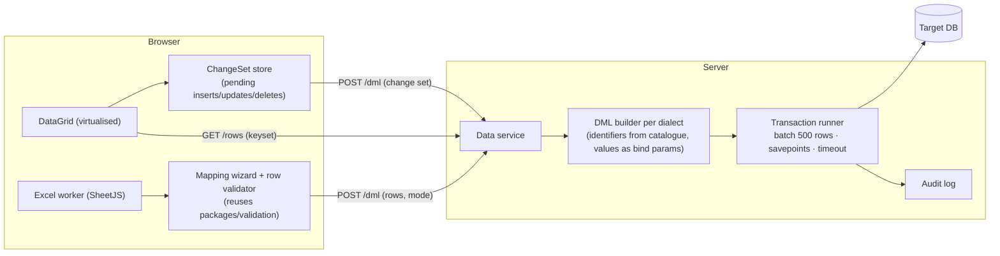

*Figure P7-3 — Data flow for grid edits and Excel imports. Both produce the same request format, so there is one code path for executing DML.*

**DML request format**

```json
{
  "table": { "schema": "public", "name": "orders" },
  "mode": "upsert",
  "key": ["id"],
  "rows": [{ "id": 1002, "status": "paid", "total": 35.00 }],
  "deletes": [{ "id": 1007 }],
  "options": { "dryRun": false, "batchSize": 500, "idempotencyKey": "01J…" }
}
```

**Safety rules:** write mode must be enabled on the connection. The SQL preview must be confirmed. Rows are matched by PK or a unique key only (never full-table updates). There is a configurable maximum number of rows per apply, and every apply is logged in the audit trail.

### Key sequence — edit in grid and apply

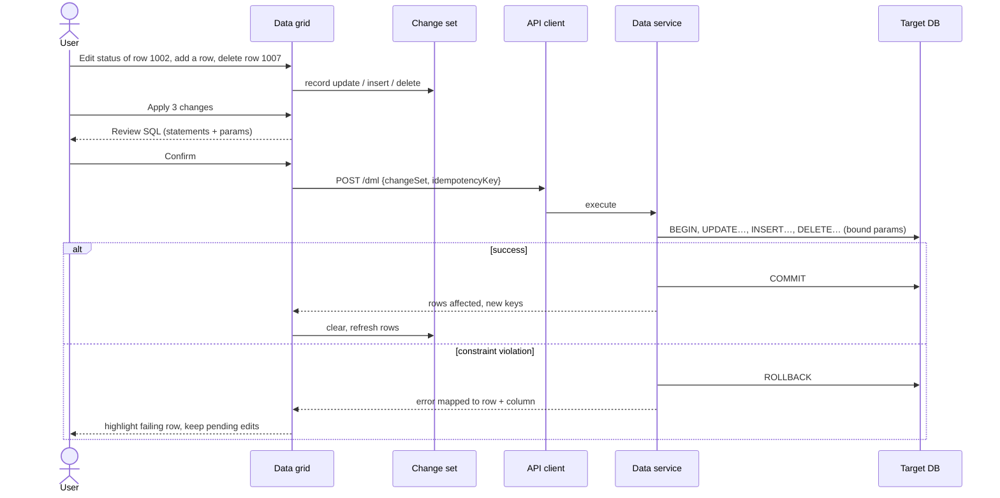

### Acceptance criteria

1. Importing a 50,000-row workbook into a table on each engine completes in < 60 s with insert mode, and either fully succeeds or fully rolls back.
2. Upsert mode updates existing rows and inserts new ones correctly on every engine.
3. FK lookups during import resolve values (e.g. email → id) and report unresolved values per row.
4. No SQL is ever built by concatenating user values (verified by tests and code review).
5. Grid edits fail cleanly on constraint violations, and pending edits are kept for correction.

## Phase 8 — Performance utilities

<span class="pill">5 weeks</span> <span class="pill">Backend</span>

### Goal

Give users a **live view of the connected database's health and performance** inside the app: connections, throughput, cache efficiency, locks and waits, replication, storage, and the most expensive queries. Plain-language **advice** links findings back to the model (e.g. "add an index on `orders.customer_id`" opens that table on the canvas with the fix ready).

### UX design

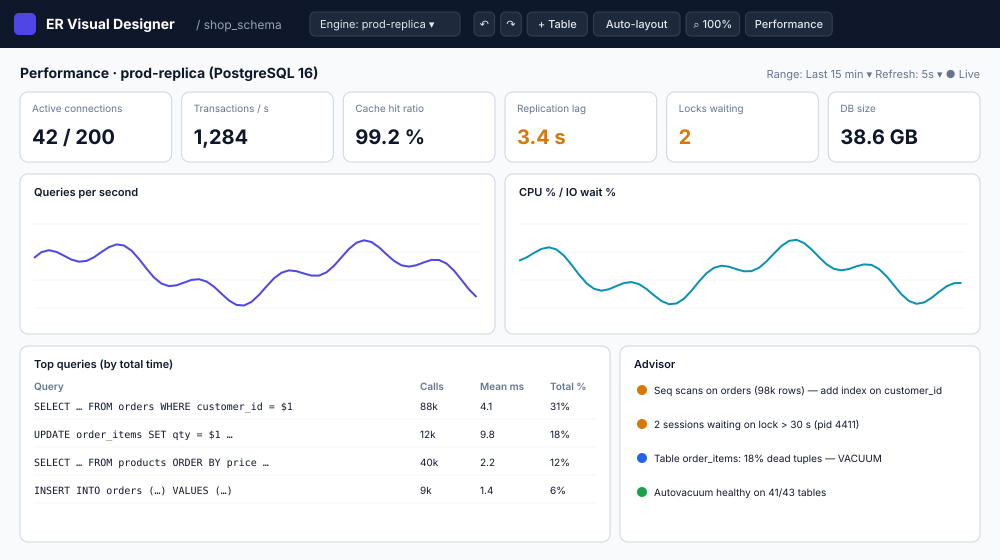

*Figure P8-1 — Performance dashboard. KPI tiles with thresholds, time-series charts (15 min to 24 h ranges), top queries by total time, and an Advisor panel.*

- **Overview:** KPI tiles (active / max connections, transactions per second, cache hit ratio, replication lag, waiting locks, database size), each with a sparkline and a threshold colour.
- **Charts:** queries per second, CPU / IO wait (where the engine exposes it), connections by state, and top wait events. They support time-range selection and pause/resume of live updates.
- **Top queries:** normalised statement, calls, mean and total time, rows, and percentage of total time. Clicking one opens **query detail** with the execution plan (EXPLAIN, without ANALYZE by default) shown as a tree, with the most expensive nodes highlighted.
- **Sessions & locks:** active sessions with running time and blocking chains. *Cancel query* / *terminate session* need write mode plus confirmation, and are audited.
- **Table insights:** size, row count, sequential vs. index scans, and dead tuples / fragmentation, shown as a heat overlay on the canvas tables ("performance lens").
- **Advisor:** rules that turn metrics into suggestions (missing FK index, unused index, table bloat, long-running transaction), each with a link to the element on the canvas or to the DDL fix.

### Technical design

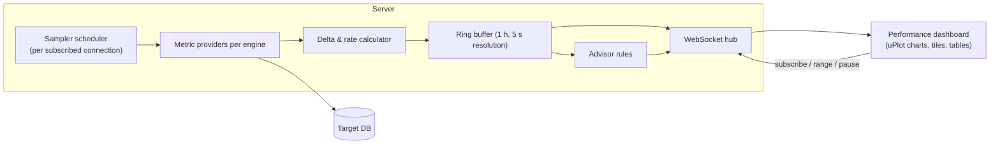

*Figure P8-2 — Metrics are sampled only while someone is watching, over a separate low-priority connection with short timeouts, so the tool adds negligible load.*

| Metric area | PostgreSQL | MySQL | SQL Server | Oracle | SQLite |
|---|---|---|---|---|---|
| Sessions / connections | `pg_stat_activity` | `performance_schema.threads`, `SHOW PROCESSLIST` | `sys.dm_exec_sessions` / `requests` | `V$SESSION` | n/a (embedded) |
| Throughput | `pg_stat_database` (xact_commit/rollback) | `SHOW GLOBAL STATUS` (Com_*, Questions) | `sys.dm_os_performance_counters` | `V$SYSSTAT` | n/a |
| Top queries | `pg_stat_statements` (extension) | `performance_schema.events_statements_summary_by_digest` | `sys.dm_exec_query_stats` / Query Store | `V$SQLSTATS` | n/a |
| Locks & waits | `pg_locks`, `wait_event` | `performance_schema.data_locks` | `sys.dm_tran_locks`, `sys.dm_os_wait_stats` | `V$LOCK`, `V$SESSION_WAIT` | n/a |
| Storage | `pg_total_relation_size`, `pg_stat_user_tables` | `information_schema.TABLES` | `sys.dm_db_partition_stats` | `DBA_SEGMENTS` | `PRAGMA page_count` × `page_size`, `dbstat` |
| Replication | `pg_stat_replication` | `SHOW REPLICA STATUS` | `sys.dm_hadr_*` | `V$DATAGUARD_STATS` | n/a |

*Some sources need extra setup or privileges: the `pg_stat_statements` extension, `performance_schema` enabled, `VIEW SERVER STATE` (SQL Server), `SELECT_CATALOG_ROLE` (Oracle). Oracle AWR/ASH views need the Diagnostics Pack licence and are **not** used by default. When a source is unavailable, the dashboard shows what is missing and how to enable it. SQLite gets a reduced "file & table stats" view.*

### Key sequence — advisor finding to model fix

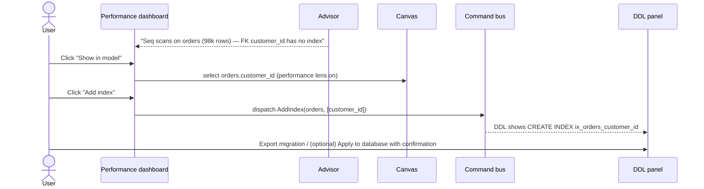

### Acceptance criteria

1. The dashboard shows live metrics on PostgreSQL, MySQL, SQL Server and Oracle in CI environments, and a reduced view on SQLite.
2. Monitoring overhead stays below 1 % CPU on the target database at a 5 s interval (measured with a benchmark workload).
3. Missing privileges or extensions are detected and explained, with no unhandled errors.
4. Each advisor rule has a test fixture, and its suggested fix produces valid DDL for that engine.

## Cross-phase considerations

### Release & versioning

| Release | Contents | Audience |
|---|---|---|
| 0.1 (alpha) | Phase 1 | Internal design partners |
| 0.5 (beta) | Phases 1–5: a complete offline modelling tool | Public beta, static hosting |
| 1.0 | Phases 1–6: connected modelling | General availability |
| 1.x | Phases 7–8, released behind feature flags | Opt-in, then general availability |

### Decisions needed before each phase

| Before | Decision |
|---|---|
| Phase 1 | Confirm tech stack (§3.3 of the design). Confirm tier-1 browsers and devices. ~~Choose a design system and branding~~ ✅ **Decided 8 Nov 2026: Sunrise Studio** (design §9.1) |
| Phase 2 | Confirm tier-1 engine versions. Decide the rule severity defaults policy |
| Phase 6 | Hosting model (SaaS / on-premises / both). Authentication provider. Where projects are stored. Security review and threat model |
| Phase 7 | Write-access policy (who may enable write mode). Audit retention. Data size limits |
| Phase 8 | Sampling defaults. Privileges to document per engine. Whether to support historic metrics (needs storage) |

### Top risks across the programme

| Risk | Phase | Mitigation |
|---|---|---|
| Engine differences larger than expected | 2, 4, 6 | Conformance tests against real engines from Phase 2. Treat dialect facts as tested data |
| Backend arrives late and becomes a bottleneck | 6 | Backend spike during Phases 4–5. Keep packages shared between client and server |
| Unsafe writes to production databases | 7 | Read-only default, previews, transactions, audit, optional "non-production only" labels |
| Monitoring load or privilege friction | 8 | On-demand sampling, low-priority connection, clear privilege guidance |
| Scope creep (views, procedures, collaboration) | all | Model designed for these, but they are kept out of scope until after 1.0 |
